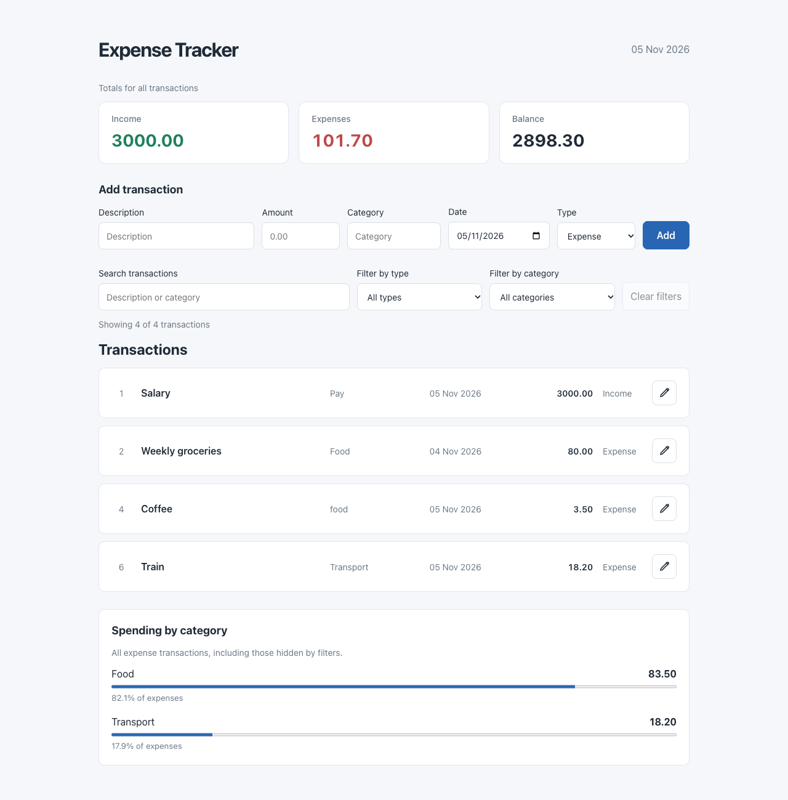

# Expense Tracker

A full-stack app for tracking income and expenses. Add, edit or delete transactions, filter your history by description, category or type, and see your balance and spending by category. Transactions are saved locally and survive a restart.

**Stack:** React, TypeScript and Vite on the frontend, with a Node.js and Express REST API backed by SQLite.



## Run locally

From the repository root, install dependencies with Node.js 22.13 or later on the 22.x line, or Node.js 24 or later, and npm:

```sh
npm --prefix my-react-app ci
```

Start the API in one terminal:

```sh
npm --prefix my-react-app run dev:api
```

Start the frontend in a second terminal:

```sh
npm --prefix my-react-app run dev
```

Open the URL printed by Vite, usually `http://localhost:5173`. Vite forwards API requests to `http://127.0.0.1:3001`. The app creates its SQLite database on first run.

## Run the checks

```sh
npm test
npm --prefix my-react-app run typecheck
npm --prefix my-react-app run lint
```

The API tests use temporary SQLite databases and cover transaction creation, updates, deletion, validation and persistence across server restarts.

See the [app documentation](my-react-app/README.md) for the REST endpoints, database schema and production build instructions. You can also view the [mobile screenshot](my-react-app/docs/screenshots/mobile.png).
