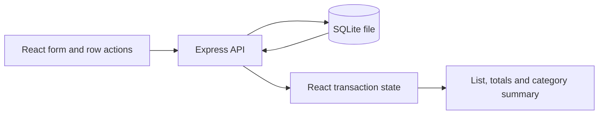
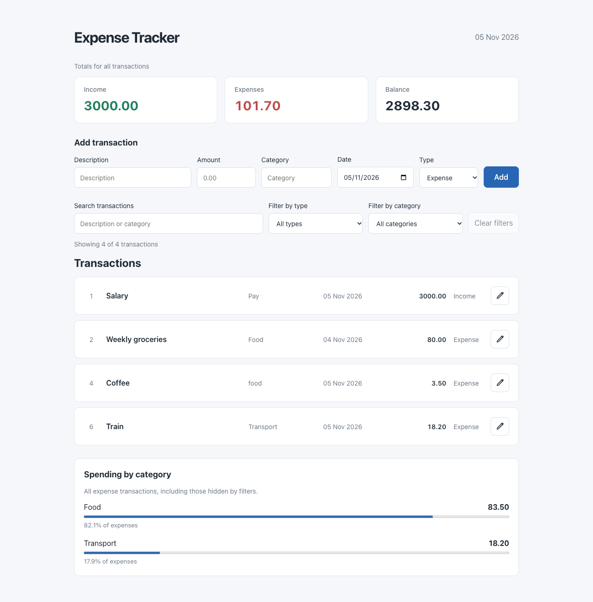
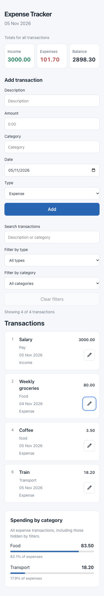

# Expense Tracker

A local expense tracker built with React, TypeScript, Express and SQLite.

Add income and expenses, edit or delete transactions with the pencil menu, and filter the history by description, category or type. Income, expenses and balance update after each successful save. The spending breakdown groups expense categories regardless of capitalization.

## Run locally

Requires Node.js 22.13 or newer and npm. Development was checked with Node.js 26.3.0. The backend uses the SQLite module included with Node.js. [Node SQLite documentation](https://nodejs.org/api/sqlite.html)

From this directory, install dependencies.

```sh
npm install
```

Start the API in one terminal.

```sh
npm run dev:api
```

Start React in a second terminal.

```sh
npm run dev
```

Open the address printed by Vite, usually http://localhost:5173. Vite forwards requests beginning with /api to the API at http://127.0.0.1:3001. The preview command uses the same proxy. [Vite proxy documentation](https://vite.dev/config/server-options.html#server-proxy)

To run the production build locally in one process, use these commands.

```sh
npm run build
npm start
```

Then open http://127.0.0.1:3001. Express serves both the built frontend and the API.

## Using the tracker

1. Enter a description, positive amount, category, date and transaction type, then press Add.
2. Use a row's pencil button to choose Edit or Delete. Editing fills the form, where Save changes commits the update and Cancel discards the draft.
3. Combine the search, type and category filters. Clear filters restores the full history.
4. Totals and spending summaries include every saved transaction, including rows hidden by filters.

An empty database starts with an empty history. Failed saves keep the form draft, and failed deletes keep the row visible. A failed initial load offers Retry loading. Buttons pause while a save or delete is pending.

## How the pieces connect



App.tsx owns the displayed transaction state. Its effect loads saved records and cancels obsolete requests. The API client serializes calendar dates as YYYY-MM-DD and parses them into local Date objects when reading responses.

Form callbacks wait for POST or PUT to succeed before updating React state or clearing the draft. DELETE removes a row after the API confirms deletion. Filters and summaries are derived from the saved transaction list.

## SQLite table and storage

The database is created automatically at data/transactions.sqlite. The data directory is ignored by Git. Records survive browser refreshes and API restarts.

The schema lives in [server/schema.sql](server/schema.sql).

| Column | Storage | Purpose |
| --- | --- | --- |
| id | INTEGER PRIMARY KEY AUTOINCREMENT | Stable transaction identity |
| description | TEXT NOT NULL | Description with nonempty validation |
| category | TEXT NOT NULL | Category with nonempty validation |
| amount_cents | INTEGER NOT NULL | Positive money value stored in cents |
| date | TEXT NOT NULL | Calendar date in YYYY-MM-DD format |
| type | TEXT NOT NULL | Income or Expense |

For example, 12.34 is stored as 1234 cents. SQLite constraints protect required values, positive amounts and transaction types. API validation also checks real calendar dates and at most two decimal places. Prepared statements bind supplied values separately from SQL.

Copy the database file while the API is stopped to back up local data. For an isolated database, set TRACKER_DB_PATH before starting the API. PORT changes the server port. If changing the development API port, update the proxy target in vite.config.js too.

## API

The base path is /api/transactions.

| Method | Path | Successful response |
| --- | --- | --- |
| GET | /api/transactions | 200 with an array |
| GET | /api/transactions/:id | 200 with one transaction |
| POST | /api/transactions | 201 with the created transaction |
| PUT | /api/transactions/:id | 200 with the replacement transaction |
| DELETE | /api/transactions/:id | 204 with an empty body |

POST and PUT accept all five editable fields.

```json
{
  "description": "Groceries",
  "category": "Food",
  "amount": 64.8,
  "date": "2026-11-05",
  "type": "Expense"
}
```

The server generates IDs and preserves them when editing. Invalid input returns 400, missing records return 404, oversized bodies return 413 and unexpected failures return 500. Error responses contain an error message.

## Checks

Run `npm test` from either the `Transaction_tracker` folder or its `my-react-app` subfolder. The outer folder forwards the command to the app. Tests start local API servers on automatically assigned ports.

```sh
npm test
npm run typecheck
npm run lint
npm run build
```

The committed API suite in tests/api.test.js runs the actual server with temporary SQLite files and ephemeral ports. It covers CRUD, input validation, malformed requests, SQL parameter binding, concurrent creates, exact cent storage and persistence across server restarts. Each run cleans up its test databases.

Local verification also covers API failure recovery and JSON error responses. Browser verification covers creating, editing, deleting, filtering, category summaries, refresh persistence, loading and failure recovery.

The ESLint configuration currently checks JavaScript files. TypeScript files are checked with the separate typecheck command.

## Screenshots

These screenshots use demonstration records in a separate temporary database.





## Current scope

This MVP is for one person using a local computer. It has a shared local SQLite database and loopback-only API binding. Accounts, authentication and multi-device synchronization would require additional work.
